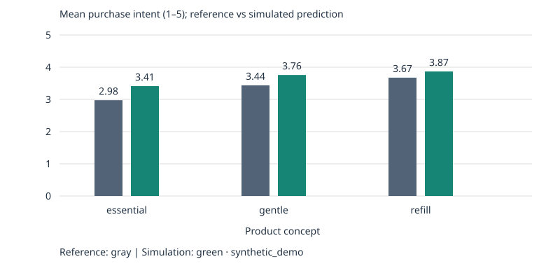

# Synthetic Consumer Personas — LLM Validation for Consumer Insights

An independent, runnable research prototype prepared for an application to **Essity — AI Personas for Innovation Decision-Making**. It is not an Essity project, endorsement, or completed thesis.

**Evidence status: synthetic demonstration only. No real consumers have been validated. No live paid LLM calls were used to produce the shipped results.**

## Quick start (free, offline)

Python 3.9 or newer; no external packages required.

```bash
python -m venv .venv
source .venv/bin/activate   # Windows: .venv\Scripts\activate
python -m pip install -r requirements.txt
python -m personas demo --out runs/demo
python -m unittest discover -s tests -v
```

Open `runs/demo/report.html` in a browser. Outputs include `concept_means.svg`, `metrics.json`, `predictions.json`, and `metadata.json`. An existing nonempty output directory is never overwritten; choose a new directory for another run. The committed example is in [examples/demo/report.html](examples/demo/report.html) (download/open locally; GitHub shows HTML source).



## What the project demonstrates

- Four fictional needs-based personas: value, comfort, resource consciousness, and convenience. No demographic stereotypes or real participant profiles.
- Three fictional tissue concepts and a common 1–5 purchase-intent question.
- 80 synthetic reference respondents × 3 concepts = 240 reference pairs; 3 repeated simulations = 720 predictions by default.
- Offline rule-based ratings and templated feedback; an optional real LLM provider behind explicit selection.
- Matched reference/prediction analysis: MAE, RMSE, signed and subgroup bias, exact and within-one agreement, concept Spearman correlation, and repeat stability.
- Respondent-cluster bootstrap intervals and explicit unavailable values for undefined metrics.
- Strict CSV import, provenance manifest, input hashes, recorded design/prompts, and no reference-answer leakage into LLM prompts.

The offline generator and simulator share utility assumptions. Their agreement is an engineering smoke test, **not independent validation of AI consumer behavior**. The synthetic reference is not “ground truth.” Repeated predictions for a persona share the same needs-only prompt; they do not reconstruct individual respondents.

## Optional LLM run

The adapter uses OpenAI Chat Completions JSON mode and validates returned values locally. Choose a model available to your account that supports this mode. API use may incur charges. No automatic retries or silent demo fallback occur.

```bash
export OPENAI_API_KEY='your-key'  # set locally; never commit
export OPENAI_MODEL='your-supported-model-id'
python -m personas validate \
  --reference examples/demo/inputs/reference.csv \
  --manifest examples/demo/inputs/manifest.json \
  --provider openai --runs 1 --max-calls 240 --out runs/llm-synthetic
```

This example uses synthetic references and therefore remains a synthetic benchmark even with real LLM output. The default paid-call cap is 30; increasing it explicitly permits the displayed design's larger number of calls. Secrets are environment-only; `.env.example` is not automatically loaded. The API adapter sends only authored persona needs, concept descriptions, and the question—not respondent IDs, real ratings, or feedback. Provider responses can vary; the seed does not seed API sampling. Live API execution is not verified by the offline tests; HTTP behavior is mocked.

API contract: [official OpenAI Chat Completions documentation](https://developers.openai.com/api/reference/resources/chat/subresources/completions/methods/create), checked 2026-10-20.

## Import real public responses

Read [the data contract](docs/DATA_CONTRACT.md) before mapping your source. Put imports in ignored `data/imported/`; no raw real responses ship in this repository.

```bash
python -m personas validate \
  --reference data/imported/responses.csv \
  --manifest data/imported/manifest.json \
  --provider demo --runs 3 --out runs/public-baseline
```

This evaluates a **rule-based baseline against real references**, not LLM validity. Select `--provider openai` and an explicit call cap for LLM validation. Human provenance is declared by the data owner, not authenticated by software. Incompatible products, questions or scales must not be relabeled as equivalent; update the study design or conduct a separate exploratory benchmark.

## Structure

```text
personas/             design, providers, import checks, metrics, report and CLI
 tests/               offline unit and integration tests
 examples/demo/       reproducible synthetic outputs and inputs
 docs/                research report and real-data contract
 data/                documentation; imported/private data ignored
 .github/workflows/   offline CI on Python 3.9 and 3.12
 requirements.txt     standard-library-only dependency policy
 .env.example         environment-variable names; no credentials
```

See [research report](docs/RESEARCH_REPORT.md) for metric definitions, limitations and the proposed validation study. Numeric bias here is prediction error by needs segment, not a complete fairness audit. Text feedback is available for human coding; semantic validity has not been scored automatically.

## Data and publication boundary

Only newly authored source code, fictional concepts, synthetic data and synthetic outputs are included. No BMW materials, private personal information, proprietary company data, or credentials are used. `.gitignore` is a convenience, not a privacy guarantee: inspect files before publishing. Do not commit real imports or generated real-data outputs without a separate rights/privacy review.

The original repository introduction is preserved verbatim in [docs/INITIAL_README.md](docs/INITIAL_README.md), alongside the initial Git commit.
